# Threadkeeper

**Keep your Claude desktop threads in order.**

- Every thread shows what it is doing: working, waiting on you, reply ready, or stopped on an error.
- Active, snoozed and finished work sit in their own sidebar sections. Say "close this" and a thread moves to Done. Say "snooze until Tuesday" and it comes back on Tuesday.
- Claude names your threads, keeps its promises to check back, and sends you a daily tidy-up list.
- A setup asks which parts you want, shows every change first, and one command removes it all.

Status: **pilot** (version 0.6.2-team.1). This edition is new. It is based on a setup used daily on Windows since November 2026. The macOS install is being tested now: if something does not work, please [open an issue](https://github.com/Kalamonde/threadkeeper/issues).

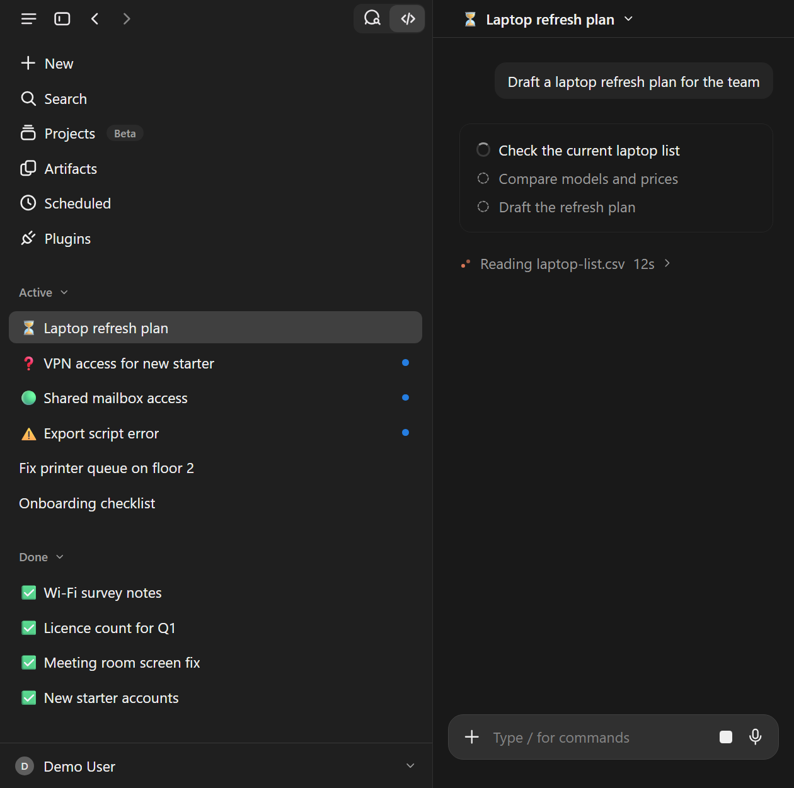

---

## The problem it solves

After a few weeks with Claude you have dozens of threads. Then:

- You lose track of which thread was about what.
- You start a new thread for something you already started, and now there are two.
- You do not know which threads are waiting for your answer and which are still working.
- Finished work and open work sit in the same long list.

Threadkeeper fixes this with small, visible signals and a few simple rules that Claude follows for you.

---

## Features

### Status icons (always on)

Each thread title starts with one icon, so you can scan the sidebar:

| Icon | Means |
|---|---|
| ⏳ | Claude is working (also while a helper agent still runs) |
| ❓ | Waiting on you: a question, a plan to approve, or a question at the end of the reply |
| 🟢 | Reply ready, you have not looked yet. It goes when you open the thread |
| ⚠️ | Stopped on an error |
| ✅ | Finished, in the Done section (with Close to Done) |
| ⏰ | Snoozed, followed by the wake time, like `⏰ 11-23 Mon 09` (with Snooze) |

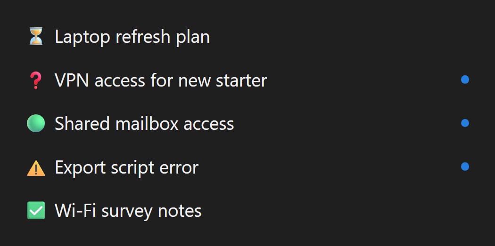

### Sections (recommended)

Setup makes new sidebar sections: **Active**, plus **Snoozed** and **Done** if you pick those parts. You choose the names. New threads go to Active on their first turn, so nothing gets lost in the plain list. Threads you put somewhere yourself stay where you put them.

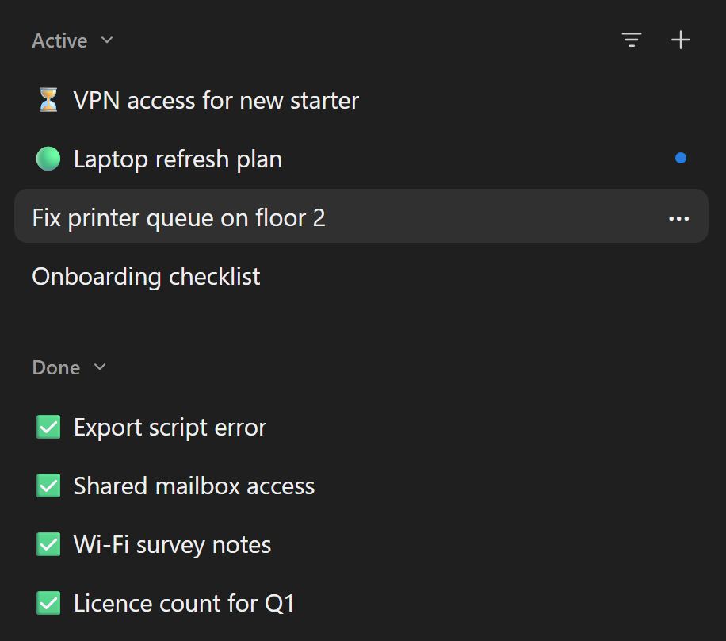

### Close to Done (recommended)

Say "close this" and Claude moves the thread to Done, where it shows ✅. When the work looks finished, Claude offers to close it with one click. New work in a closed thread moves it back to Active.

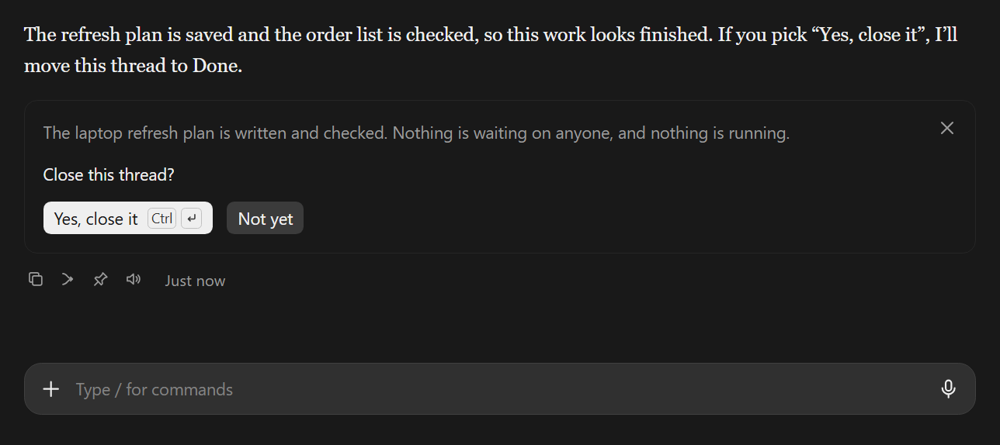

### Snooze and wake-ups

Done for now, but not finished? Say "snooze until Tuesday 10:00" (or just "snooze"). The thread moves to **Snoozed** and its title shows ⏰ and the wake time. A scheduled wake-up run (on your working days, 3 times a day) brings it back to Active with a blue dot when the time comes. Write in a snoozed thread and it wakes at once. When a thread is only waiting on someone, Claude offers to snooze it.

Threads you drag into Snoozed by hand get a wake time too: your next working day at your start time.

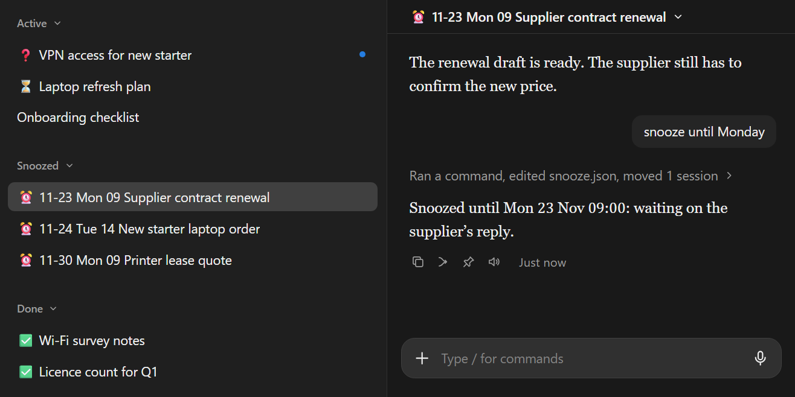

### Follow-up reminders

When Claude promises to check back ("I'll look again on Monday at 10:00"), or you ask it to remind you, it snoozes the thread and makes a one-off scheduled task. At that time the thread comes back to Active with a blue dot, and Claude starts with the promised check when you next write. Needs Snooze.

### Thread names

Claude gives each new thread a short, clear name once the work is clear. Pick a format at setup: `[TAG] Person: short title` (for example `[CHAT] Alex: VPN access on the new laptop`, with your own tags) or plain short titles. Claude never renames a title you typed yourself.

### Tidy report

Once a day, a scheduled run lists threads that look idle (no activity for 7 days), likely duplicates, and old threads in Done. It changes nothing. Reply in the report with what you want, for example "close 2 and 5, archive 3", and Claude does only those items. It never deletes a thread: archived threads can be brought back from the Archived list.

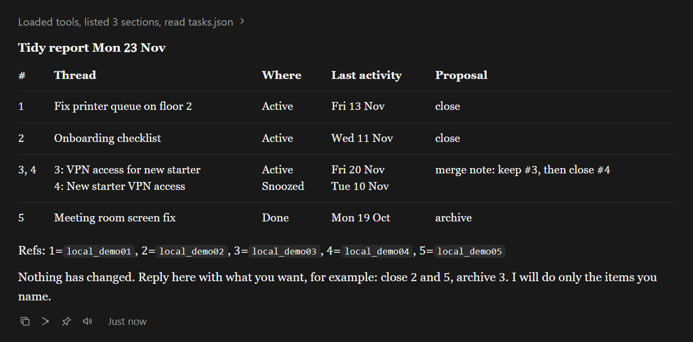

### Doctor and self-check (always on)

Threadkeeper checks itself at the start of each thread. If something breaks (for example after an app update, or a section was deleted), a yellow line above the prompt tells you, and `/threadkeeper:doctor` shows what is wrong and how to fix it. It also checks the scheduled tasks, their model and their last runs.

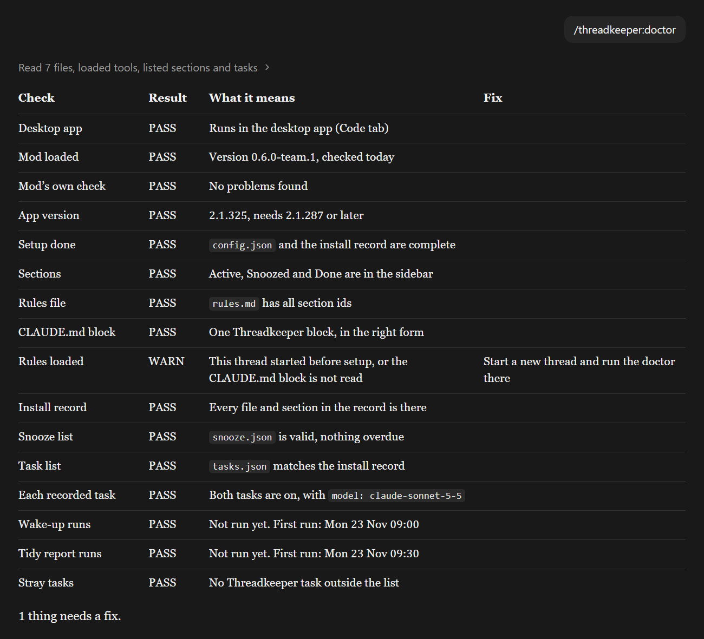

### Coming next

| Module | What it will do |
|---|---|
| Context saver | When a thread gets very long, Claude saves the key facts to a notes file and offers to shorten the thread. Long threads use your limits much faster |
| Watchdog (Windows) | Checks Threadkeeper every few hours, even when Claude is closed |

---

## How it works

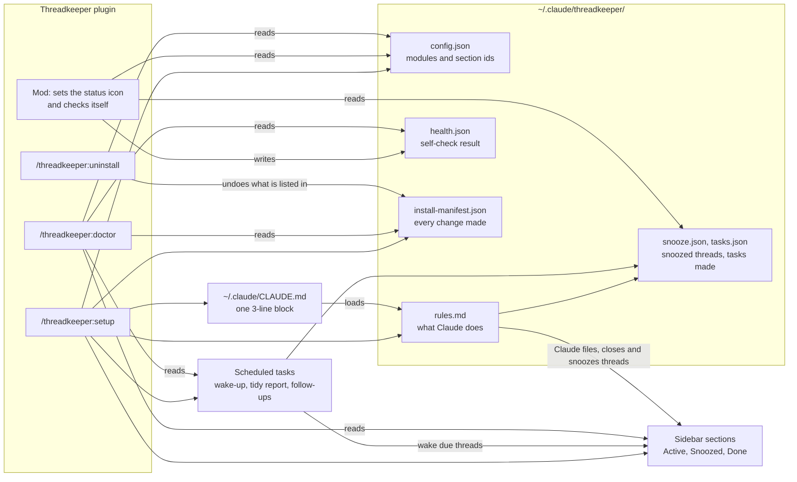

- **The mod** runs inside the Claude app. It only changes the icon at the start of the thread title (and the wake time after ⏰). It never moves threads, and it leaves a ⏰ or ✅ from another tool alone.
- **The rules** are plain text that Claude reads at the start of each thread. They tell Claude when to file, close, snooze and name a thread.
- **The scheduled tasks** are short, fixed instructions that run on their own: they wake snoozed threads and write the tidy report.
- **The files** keep the setup in one folder, so the doctor can check it and the uninstall can remove it exactly.

---

## INSTALLATION INSTRUCTIONS

You need the **Claude desktop app** (Code tab), version 2.1.287 or later. About 10 minutes.

### The easy way: give Claude the install file

Open a new thread in the Code tab and paste this:

> Install Threadkeeper by following https://github.com/Kalamonde/threadkeeper/blob/main/INSTALL.md exactly.

Click **Allow** when it asks (about three times). Then start a new thread, pick **Auto** in the mode menu next to the prompt box, and type `/threadkeeper:setup`. Auto saves you an Allow click for every file setup writes, and the scheduled parts need it (see [Choosing modules](#choosing-modules)). No Auto in the menu? Stay in your normal mode and click Allow.

### By hand: macOS and Windows

1. In the desktop app's sidebar, open **Plugins** (on some versions: **Customize**, then **Plugins**).
2. Click **Add**, then **Add marketplace**, then **Add from a repository**, and enter `Kalamonde/threadkeeper` (if it asks for a full URL: `https://github.com/Kalamonde/threadkeeper.git`).
3. Install **Threadkeeper** from that marketplace.
4. Start a new thread, pick **Auto** in the mode menu next to the prompt box, and type `/threadkeeper:setup`.

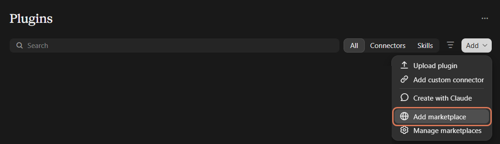

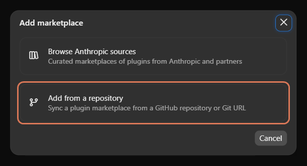

From a terminal instead:

```bash
claude plugin marketplace add Kalamonde/threadkeeper
claude plugin install threadkeeper@threadkeeper --scope user
```

The repository is public: you do not need a GitHub account.

---

## Choosing modules

Status icons are always on. `/threadkeeper:setup` asks:

1. **Basics:** Sections, Close to Done, Thread names.
2. **Automation:** Snooze and wake-ups, Follow-up reminders, Tidy report. These use scheduled tasks.
3. The details for what you picked: section names, when your working day starts, which days you work, the name format and tags, and the tidy report time.
4. One OK, after it shows the full list of changes.

Some parts need others: Close to Done, Snooze and the Tidy report need Sections, and Follow-up reminders need Snooze. Setup adds what is missing and tells you.

**Run setup in Auto mode** if you pick any automation (the mode menu next to the prompt box). Scheduled tasks keep the mode of the thread that made them. In other modes, each wake-up run stops and waits for you to allow it. Setup checks this and asks first.

Every scheduled task runs on a set model (Sonnet 5.5), never the app's default. Tasks run only while the app is open and the computer is awake; a missed run happens at the next chance.

To change your choice later: `/threadkeeper:uninstall`, then `/threadkeeper:setup`.

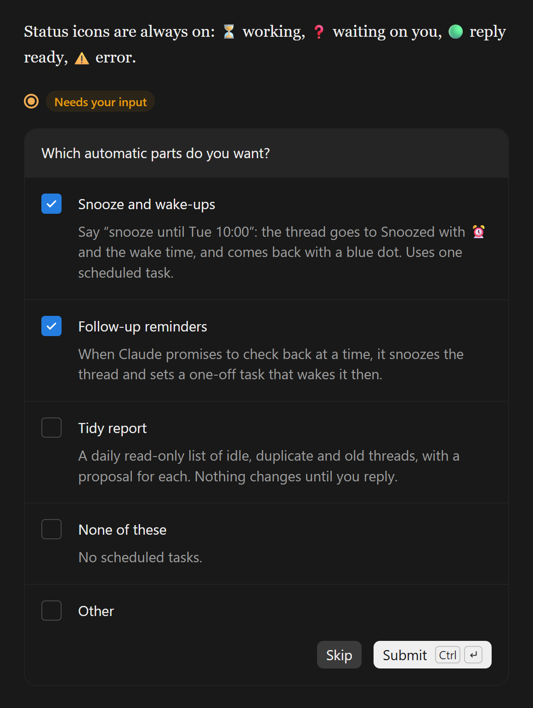

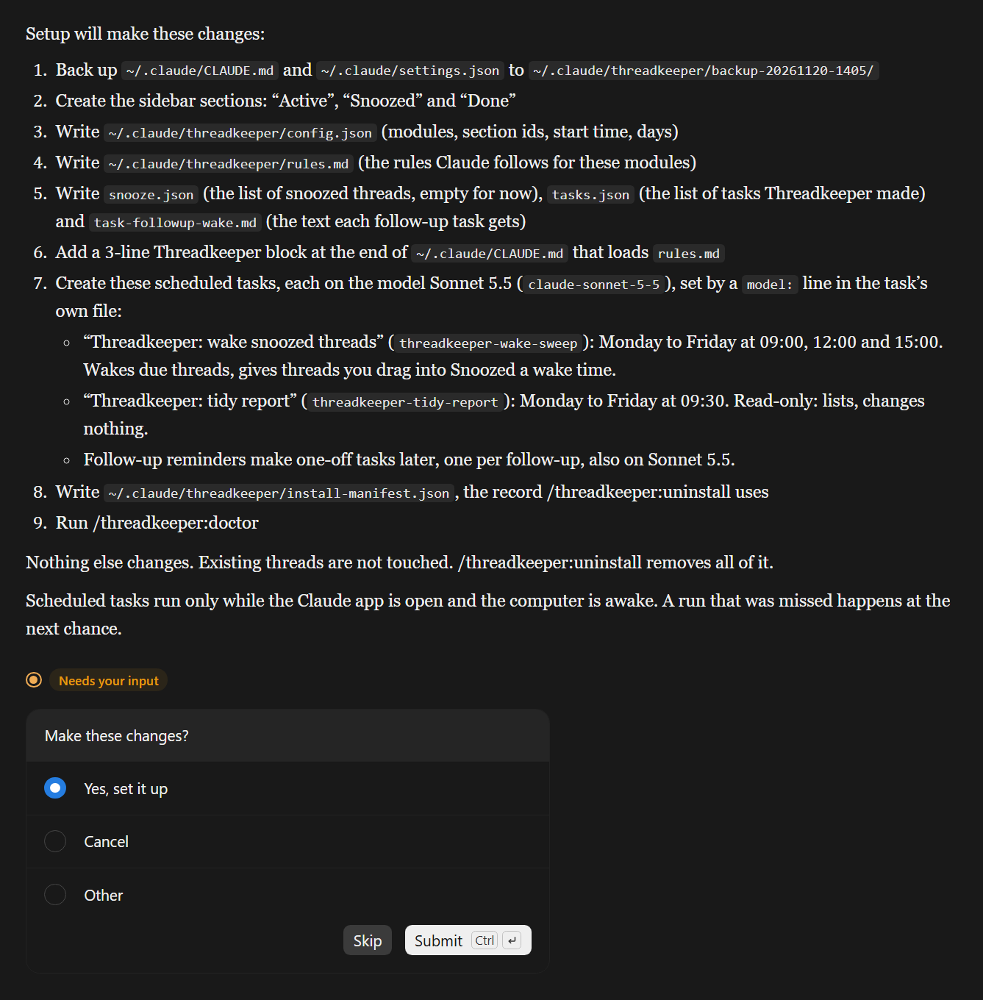

---

## What it will never do

- Change your existing threads on its own. It never renames, moves, closes or archives threads you have now, unless you name them (for example in a reply to the tidy report).
- Delete a thread. Ever. The most it does is archive one you named, and archived threads can be brought back.
- Edit your own rules. It adds one marked 3-line block at the end of `~/.claude/CLAUDE.md` and nothing else.
- Touch `settings.json` (it only keeps a backup copy).
- Use an existing sidebar section. It creates its own.
- Change a ⏰ or ✅ that another tool put on a thread. The mod, the wake-up run and the uninstall only touch the ⏰ and ✅ on threads in Threadkeeper's own sections or snooze list. Still, use one snooze system, not two: an older one may not leave Threadkeeper's ⏰ alone.
- Need admin rights, Python or PowerShell.
- Carry on after an error. Setup stops, runs the doctor and tells you to send the result.
- Leave things behind. Every change is listed in `install-manifest.json`, and the uninstall removes exactly that list.

Before it changes anything, setup backs up `CLAUDE.md` and `settings.json` into `~/.claude/threadkeeper/backup-<date>/`.

---

## Troubleshooting

Type `/threadkeeper:doctor` in any thread. It checks the app, the plugin, the files, the sections and the rules, and shows a table with a fix for each problem.

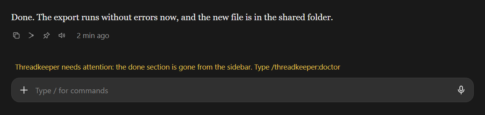

| You see | Do this |
|---|---|
| No icons at all | Check Threadkeeper is on in **Plugins** (Your plugins). Start a new thread |
| "Threadkeeper needs attention" above the prompt | Type `/threadkeeper:doctor` |
| New threads do not go to Active | The rules load when a thread starts: try a new thread. Then run the doctor |
| A snoozed thread did not wake on time | The app must be open and the computer awake at the wake-up times. It catches up at the next run. If it still does not wake, run the doctor |
| A Threadkeeper run under **Scheduled** is waiting | It is asking for permission to move a thread: open it and allow it. To stop this, run setup in Auto mode (uninstall, then setup) |
| Anything else | Run the doctor and send its output to whoever shared Threadkeeper with you, or [open an issue](https://github.com/Kalamonde/threadkeeper/issues) with it |

---

## Uninstall

Type `/threadkeeper:uninstall`. It deletes the scheduled tasks Threadkeeper made (and no others), then removes the rules, its files and the `CLAUDE.md` block. It asks whether to keep or delete its sections, whether to move snoozed threads back to Active, and whether to clean Threadkeeper's icons from thread titles (a ⏰ or ✅ from your own setup stays). Your backups stay. Then remove the plugin: **Plugins**, Your plugins, Threadkeeper, **Uninstall** (or in a terminal: `claude plugin uninstall threadkeeper@threadkeeper`).

---

## FAQ

**Why is this not just an .md file with instructions?**
A file of instructions makes Claude rebuild the setup from scratch each time, and every result comes out a bit different. Threadkeeper is a set of parts that work together: a mod in the app, rules, sidebar sections and checks. As a plugin, everyone gets the same tested parts, a record of what was installed, a doctor when something breaks, and a clean uninstall. You still give Claude one file: [INSTALL.md](INSTALL.md).

**Does it read my threads?**
The mod reads only the current thread's title and section. The wake-up run and the tidy report read thread titles, sections and last activity times, not what is in the threads. The doctor reads Threadkeeper's own files. Nothing goes anywhere beyond your normal use of Claude.

**Does it cost tokens?**
The icons and checks cost nothing: the mod runs in the app, not in the model. The rules add a few lines to each thread's instructions. The scheduled tasks use a little of your usage: the wake-up run 3 times a working day and the tidy report once, both on Sonnet 5.5.

**Does it work in the terminal or VS Code?**
No. It needs the desktop app's sidebar. In other places it stays quiet.

**Windows or Mac?**
Both, by design. The setup it comes from has run daily on Windows since November 2026. This edition is new, and its first pilot is on macOS.

---

## License

MIT, see [LICENSE](LICENSE). Free to use, change and share. No warranty: it is a personal project, used at your own risk.
